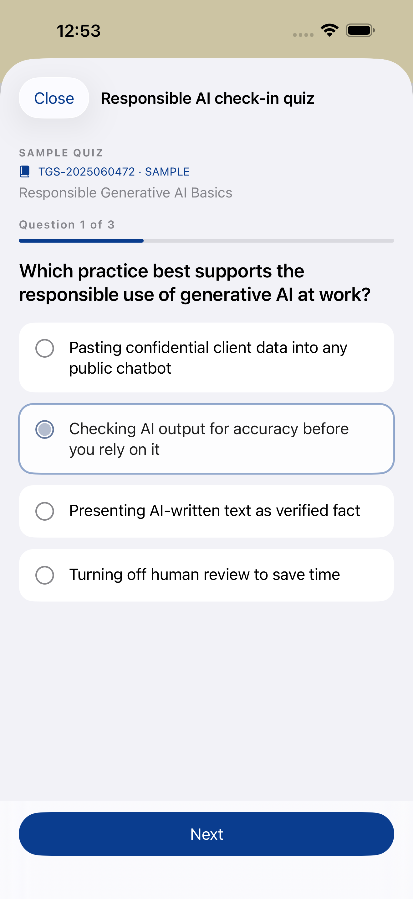

# TIA TMS — native iOS app

A SwiftUI iPhone and iPad app for [AI-LMS-TMS](https://github.com/alfredang/AI-LMS-TMS), restricted to registered learners and trainers of Tertiary Infotech Academy, with read-only Admin and Developer views for allow-listed staff.

- Sign in with an email code or the portal password; Keychain session storage and server-side logout.
- Classes and a Singapore-time calendar, with Apple Calendar export.
- Class page in the website's section order and names, laid out for the phone: a summary card (course code, run, class type and status, dates, venue with Google Maps, trainer, Join Google Meet / Zoom / Teams), then collapsible sections that start closed: Course Details (TSC, funding validity, hours), E-Attendance, SWDA Enrolment, Announcements, Courseware, Lesson, Course Feedback & TRAQOM Survey, Briefing on Assessment, Assessment, Assessment Summary Record, Assessment Grading and Post Course Feedback Summary.
- Courseware for each class, in the website's names and order; PDFs (and Google files that export as PDF) open inside the app.
- Attendance: learners scan the trainer's class QR code; trainers show the QR code or mark attendance manually; SSG e-attendance opens on MySkillsFuture.
- Assessments: learners submit files for published assessments; trainers publish each assessment and record Competent / Not Yet Competent.
- Assessment Summary Record e-signing: learners sign as candidate, trainers sign as assessor (one by one or all at once), with a finger-drawn signature saved once.
- Post Course Feedback Summary for trainers: average per question, overall score and comments, without learner names.
- Trainers post class announcements with a photo or file, and grade from a roster that shows each learner's WA / PP submissions, a TRAQOM tick and the assessor signature on submitted files.
- Certificates: learners (tab) and trainers (Account) view and download their certificates.
- Class status (Confirmed, Pending, Cancelled) on every class card; a learner Support tab (feedback emailed to the academy, email, tel, WhatsApp, address).
- Trainer credentials: ACLP, DDDPL and TAEPP badges with toggles, domain expertise and skill tags.
- Roles: an admin Google sign-in shows Admin; the owner account can switch the view between Learner, Trainer, Developer and Admin.
- Admin: Current and Upcoming classes, an academy calendar, the course catalogue, and WhatsApp a trainer about a class (prefilled message). Developer: the course catalogue. Both are read-only; class status and trainer assignment stay on the website, where TPGateway is updated.
- Class quizzes: scanning the trainer's quiz QR code (`https://lms-tms.tertiaryinfotech.com/quiz/<courseId>/<quizId>`) opens the quiz in the app through a universal link; one question at a time, then the marked result, with retake. A signed-out learner signs in first and the quiz opens straight after.
- Course feedback form and the TRAQOM survey link.
- Profile editing and a light/dark theme saved to the user's profile.
- Reminders three days and one day before class (APNs) and on the morning of class (on device).
- Native Feedback, About, notification settings and account deletion.
- Clearly labelled sample learner/trainer experiences for App Review, covering every screen.

## Build

Requires Xcode 26 and XcodeGen. Minimum iOS 17.

```sh
xcodegen generate
xcodebuild -project TertiaryLearning.xcodeproj -scheme TertiaryLearning -destination 'platform=iOS Simulator,name=iPhone 17 Pro Max' test
```

`project.yml` is the project source of truth. Bundle ID: `com.tertiaryinfotech.ailmstms`. Apple team: `GU9WTSTX9M`.

## Backend

The live server code is the AI-LMS-TMS repository (`lib/mobile/app.ts` builds the class page data); the `backend/` checkout here is an older copy. Mobile routes derive identity from a verified server-side session and validate the selected role. No user IDs from the device are trusted for data access.

`/api/mobile/auth` and `/login` sign users in; `/me`, `/dashboard`, `/class`, `/attendance`, `/assessments`, `/feedback`, `/profile`, `/hours`, `/certificates`, `/support`, `/trainer-profile`, `/staff` (admin/developer, read-only), `/device` and `/delete-account` serve the native app (contract: `docs/mobile-app-api.md` in the backend). Class quizzes use the portal's `/api/courses/quiz` and `/api/courses/submit-quiz` with the same session token; the server marks the answers. Assessment publishing (`/api/assessments/publish-link`), summary-record signing (`/api/assessments/summary-record`) and saved signatures (`/api/learner/signature`, `/api/trainer/assessor-signature`) also use the portal's own routes, which check the class trainer or the enrolled learner. The portal serves `/.well-known/apple-app-site-association` for `GU9WTSTX9M.com.tertiaryinfotech.ailmstms` (paths `/quiz/*`), matching the app's `applinks:lms-tms.tertiaryinfotech.com` entitlement. `/send-reminders` accepts only the configured machine API key. Read [the backend configuration guide](https://github.com/alfredang/AI-LMS-TMS/blob/main/docs/mobile-ios.md) for configuration and verification. The backend is a separate repository and is intentionally excluded from this app repository.

## Release

This repository contains the iOS app source only. Build output, App Store submission tooling and internal release records are intentionally excluded, as is the backend, which lives in its own repository. Never commit `.env`, signing keys or provisioning profiles.

## Release notes

- **1.1 (11)**: Signatures are drawn on the phone each time; trainer announcements with photos and files; Assessment Grading roster (WA/PP ticks, TRAQOM, assessor signing); certificates to view and download; class status on every class card; learner Support tab; trainer credential badges (ACLP, DDDPL, TAEPP), domain expertise and skill tags; developer funding validity with expiry alerts.
- **1.1 (10)**: Class page mirrors the website in a phone layout; assessment publishing, summary-record e-signing and the feedback summary; owner role switch; Admin and Developer views with WhatsApp a trainer.
- **1.1 (8)**: Scan a quiz QR code to take class quizzes in the app.
- **1.0 (7)**: Attendance, assessments, course feedback, in-app PDF courseware, profile and theme.

## Preview



