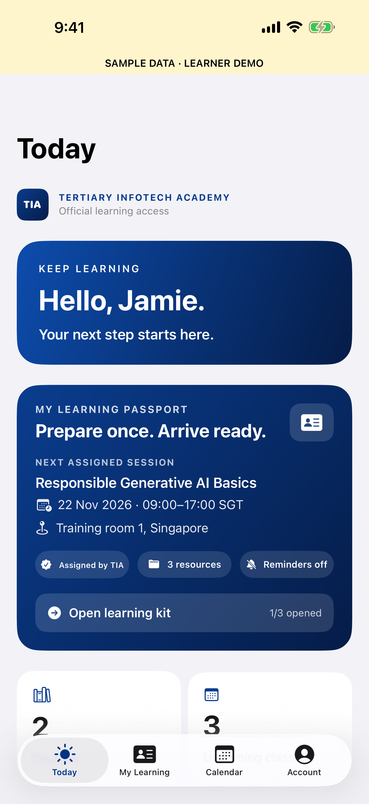

# TIA TMS — native iOS app

A SwiftUI iPhone and iPad app for [AI-LMS-TMS](https://github.com/alfredang/AI-LMS-TMS), restricted to registered learners and trainers of Tertiary Infotech Academy.

- Sign in with an email code or the portal password; Keychain session storage and server-side logout.
- Classes and a Singapore-time calendar, with Apple Calendar export.
- Courseware for each class; PDFs (and Google files that export as PDF) open inside the app.
- Attendance: learners scan the trainer's class QR code; trainers show the QR code or mark attendance manually; SSG e-attendance opens on MySkillsFuture.
- Assessments: learners submit files for published assessments; trainers record Competent / Not Yet Competent.
- Course feedback form and the TRAQOM survey link.
- Profile editing and a light/dark theme saved to the user's profile.
- Reminders three days and one day before class (APNs) and on the morning of class (on device).
- Native Feedback, About, notification settings and account deletion.
- Clearly labelled sample learner/trainer experiences for App Review, covering every screen.

## Build

Requires Xcode 26 and XcodeGen. Minimum iOS 17.

```sh
xcodegen generate
xcodebuild -project TertiaryLearning.xcodeproj -scheme TertiaryLearning -destination 'platform=iOS Simulator,name=iPhone 17 Pro Max' test
```

`project.yml` is the project source of truth. Bundle ID: `com.tertiaryinfotech.ailmstms`. Apple team: `GU9WTSTX9M`.

## Backend

The isolated `backend/` checkout contains the companion changes to AI-LMS-TMS. Mobile routes derive identity from a verified server-side session and validate the selected role. No user IDs from the device are trusted for data access.

`/api/mobile/auth` and `/login` sign users in; `/me`, `/dashboard`, `/class`, `/attendance`, `/assessments`, `/feedback`, `/profile`, `/device` and `/delete-account` serve the native app (contract: `docs/mobile-app-api.md` in the backend). `/send-reminders` accepts only the configured machine API key. Read [the backend configuration guide](https://github.com/alfredang/AI-LMS-TMS/blob/main/docs/mobile-ios.md) for configuration and verification. The backend is a separate repository and is intentionally excluded from this app repository.

## Release

This repository contains the iOS app source only. Build output, App Store submission tooling and internal release records are intentionally excluded, as is the backend, which lives in its own repository. Never commit `.env`, signing keys or provisioning profiles.

## Preview


